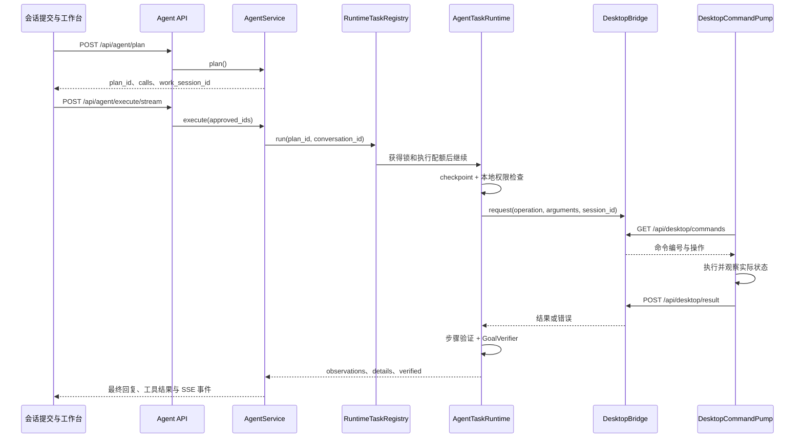

# Agent Runtime：路由、规划与执行

本文说明当前源码的任务执行链路。Companion Studio 使用自己的轻量协调层，将模型工具选择、本地权限、桌面观察与工作台状态关联起来；没有引入第三方 Agent 框架或多 Agent 分布式调度。本地审核分支新增保守的检查点恢复，详见 [Agent Recovery](AGENT_RECOVERY.md)。

## 1. 模块职责

| 模块 | 当前职责 |
| --- | --- |
| `desktop/frontend/src/ConversationSubmissionService.ts` | 提交会话请求，区分普通聊天与任务，关联流式回复和会话所有权。 |
| `desktop/frontend/src/api.ts` | 封装路由、规划、执行和工作状态 HTTP / SSE 接口。 |
| `backend/app/api/agent.py` | 校验请求字段，将规划、执行、候选应用选择交给服务层。 |
| `backend/app/services/agent_router.py` | 根据模式、本地动作意图和任务表达选择 `chat` 或 `agent`。 |
| `backend/app/services/agent_service.py` | 构建上下文、生成并保存计划、协调执行结果与最终回复。 |
| `backend/app/services/runtime_registry.py` | 持久记录任务所有权，限制执行并发，管理取消与超时。 |
| `backend/app/services/desktop/runtime.py` | 按工具和步骤执行、观察、重试、验证，等待用户接管。 |
| `backend/app/services/desktop/bridge.py` | 后端与 Electron 之间的有界请求 / 回复队列。 |
| `desktop/electron/desktop-app-agent.cjs` | 轮询后端命令，在桌面执行并回传实际结果。 |
| `backend/app/services/work_state.py` | 保存 Work Session、步骤、权限和模块数据，发布状态事件。 |
| `backend/app/services/desktop/goal_verifier.py` | 根据已执行工具结果进行确定性目标检查。 |

## 2. 路由与规划

`ConversationRouter.route()` 在显式 `chat` 模式下返回普通聊天。其他模式会检查 `LocalActionIntentResolver` 和任务关键词，因此 `agent` 模式也允许普通陪伴语句进入聊天流程。前端开启自动工作模式时，可以提交 `auto`，让明确的操作请求转到工作会话。

`AgentService.plan()` 按以下顺序建立计划：

1. 检查角色、会话归属及是否已删除，读取最近 20 条可见消息、关系记忆和个性化设置。
2. 使用 `CharacterPromptBuilder` 组合上下文。附件通过 `AttachmentService` 校验与准备；图片准备参考角色模型的视觉能力配置。
3. 从已保存的 Work Session 读取用户选择的项目目录，并检查路径边界；请求不能临时换成未经保存的目录。
4. 用 `CodingWriteIntentResolver` 决定代码进入虚拟草稿、补丁预览还是明确的项目写入模式。选择目录本身不会把草稿升级为实际写入。
5. 对简单本地动作生成确定性工具调用；对复杂任务调用规划模型。若执行模型不可用，可以保留已明确识别的本地动作，并说明其余任务未执行。
6. 用 `ToolRegistry` 校验工具名称和参数，再由本地代码生成权限动作及风险等级。
7. 先保存用户消息，再创建 Work Session、步骤及待确认项，保存计划，返回 `plan_id`。

计划上下文在内存中暂存，同时写入 Work Session 的 `plan_json`。内存上下文有 300 秒年龄限制，过期项由现有 15 秒监控及新规划清理，并在没有有效引用时回收对应的准备 Handle；持久化待执行计划恢复时会重新创建上下文。因此，这不是持久计划统一在 300 秒后销毁的保证。身份、执行引用和 SSE 资源边界见 [资源生命周期](RESOURCE_LIFECYCLE.md)。

### 模型职责

`ModelRoleRouter` 支持 `character_model`、`planning_model`、`tool_execution_model`、`coding_model` 四种职责。同一服务可以承担多个职责，也可以分别配置。

- 简单的本地动作可以完全不调用规划模型。
- 复杂规划优先使用指定的规划服务，工具模式可回退到执行模型，再回退到角色模型。
- 已明确配置 `tool_calling=false` 的服务不会用于工具选择；未知能力允许实际尝试。
- 角色模型负责一般工具任务的最终自然语言回复；部分已确定的本地应用、音乐结果使用本地反馈。
- 成功收到工具调用可以记录观察到的能力；空工具选择不会被当成 API 不支持工具的证据。

这里的“模型职责”是服务选择机制，不代表四个模型总会被调用。

## 3. 执行、观察与验证

`AgentTaskRuntime.run()` 顺序处理当前计划的工具。每次操作前先经过暂停 / 取消检查和本地权限判断；权限拒绝会形成失败结果，不会执行桌面工具。实际工具结果同时进入：

- `observations`：以 `role=tool` 和 `tool_call_id` 放回最终模型上下文。
- `details`：记录工具名称、状态及结果，供 API 响应和目标检查使用。
- Work Session 事件与模块：为工作台提供步骤、文件、网页、媒体或应用状态。

`step()` 将 `verified=false` 视为验证失败；异常会进入有界恢复逻辑。对未返回 `verified` 的普通文件工具，正常返回意味着步骤执行完成，并不新增桌面验证。

`GoalVerifier` 当前是结果规则检查：所有工具必须处于 `done`；播放目标需要已验证的 `music.play` 或 `media.play`；编码任务需要编码结果 `verified=true`。普通目标不做完整语义拆解，所以它不能证明模型已覆盖用户要求中的每一个子目标。

工具结束后，`AgentService` 将实际观察交给最终回复流程，保存 assistant 消息，关联 Work Session，并发出完成或失败事件。流式接口通过统一文本和语音管线输出；非流式接口可以另行排入语音任务。文字回复保存和音频播放是不同阶段，音频失败不应被解释为桌面任务没有执行。

## 4. 并发与所有权

`RuntimeTaskRegistry` 用 SQLite 的 `runtime_tasks` 表记录 `task_id`、`conversation_id`、`work_session_id`、`renderer_id`、任务类别及状态。Task ID 对应一次执行，Conversation ID 对应会话，Work Session ID 对应这次任务的工作台状态。

| 限制 | 当前实现 |
| --- | --- |
| 同类任务的会话锁 | 锁键为 `(kind, conversation_id)`；没有会话时使用 Task ID。 |
| Agent 执行配额 | 3 个。 |
| Chat 执行配额 | 4 个，流式聊天接口使用注册器。 |
| Voice 配额 | 2 个，由连续语音管线直接获取共享门。 |
| 获取会话锁 | 最多等待 120 秒。 |
| 获取执行配额 | 再最多等待 120 秒。 |
| 已进入执行的任务 | 总上下文限制 1800 秒。 |

同一会话的同类任务串行，不同会话可以在配额内并行；不同类别不共享同一会话锁。计划生成发生在 `run()` 外，不能描述为所有规划请求都受上述 Agent 门控制。SQLite 事务与桌面输入队列也有各自的串行约束，因此并发执行不等于多个任务能够同时控制同一鼠标和键盘。

任务编号在执行前检查是否活动或已写入数据库；已经执行过的编号不能重新使用。`finally` 释放已经获得的 Semaphore 与 Lock，移除活动映射和进度记录，并回收没有等待者的会话锁。清理面向当前任务，不会停止所有同名后端进程。

## 5. 暂停、取消、超时与重试

- **暂停 / 用户接管**：`TaskHandle` 清除恢复事件，后续检查点等待用户继续；检查点最多等待 600 秒。Windows 锁屏、焦点干扰等会进入等待用户状态。
- **继续**：设置恢复事件，重新观察目标状态后继续当前步骤。
- **取消**：标记 Handle、唤醒等待者，并取消当前 Session 对应的 asyncio Task。目标应用退出通过桌面观察通知设置退出原因。
- **单步骤超时**：普通步骤由 `TaskWaiter` 限制为 65 秒，编码智能体步骤为 1200 秒；桌面桥自身通常还有 60 秒请求限制。
- **重试**：分类后仅对安全只读瞬时故障及证据充分的固定恢复策略最多追加 2 次；总恢复循环 4、累计步骤 12、执行年龄 1800 秒。未知副作用、脚本、完整编码和计费模型不自动重放。预算和证据不足时停止。
- **音乐步骤**：通用运行时每阶段只运行一次，由音乐适配器承担其自身有界页面恢复，避免重复搜索或点击。
- **Watchdog**：每 15 秒检查进度；只有原因字段为空且 180 秒无进度的任务会标记 `stalled` 并取消。明确工具事件和等待由各自超时管理，不能称 Watchdog 覆盖所有等待。

取消 asyncio Task 能释放协程等待和运行配额，但 Python 线程不会因此被强制终止；脚本子进程管理仍需结合执行器自身限制。当前目录边界和进程环境清理不是 Windows 权限沙箱。相关已知问题见 [工程审计](ENGINEERING_AUDIT.md)，不要把这些边界描述为不存在。

## 6. 重启与会话状态

启动时 `RuntimeTaskRegistry` 将数据库中非终态任务标记为 `interrupted`。`WorkState.recover_interrupted()` 把部分正在执行或等待接管的工作会话标记为停止，并保留历史结果。

这不会自动重新运行已中断的工具，也不会恢复旧协程、鼠标焦点或脚本进程。待规划 / 待权限状态的计划可以从持久记录重新构建上下文，再由用户发起执行。恢复待执行计划与恢复正在执行任务是两件不同的事情。

新审核版保存 PREPARED → EXECUTING → OBSERVED → VERIFIED → COMMITTED 检查点。用户从工作流
发起恢复预览，当前计划/工作区/文件或桌面证据核验后才可续接；新执行 UUID 与原逻辑任务关联，
租约和 request UUID 去重，原权限重新检查。未知外部副作用保守转人工检查，不保证外部 Exactly Once。

Work Session 事件带有任务、会话、工作会话和渲染器关联字段。工作台通过快照与 SSE 展示进度；事件序号可以帮助客户端继续读取已保存事件。它保证事件查询能够接续，不代表工具执行能够从任意步骤自动接续。

## 7. 实例：“打开记事本。”

1. 用户在工作模式输入这句话；前端提交服务调用 `/api/agent/route`，本地动作解析将其识别为 Agent 请求。
2. `/api/agent/plan` 调用 `AgentService.plan()`，读取当前角色和会话上下文。应用别名解析器将“记事本”匹配到注册应用 `notepad`；必要时通过桌面桥刷新应用发现。
3. 因为是简单本地操作，服务直接生成 `app_launch` 工具调用，不要求模型返回 Tool Calling。参数是 `{"app":"notepad"}`，不是 EXE 路径或任意 Shell 命令。
4. 服务校验工具，生成 `app.launch:notepad` 权限动作，保存用户消息与计划，返回计划和 Work Session ID。
5. 普通已知应用启动属于低风险：智能 / 自动模式可允许，询问模式需要对应调用的一次确认。前端传递确认编号，后端执行前仍重新检查权限。
6. 执行注册器获得同类会话锁和 Agent 配额，`AgentTaskRuntime` 将 `app.launch` 发给 `DesktopBridge`。
7. Electron `DesktopCommandPump` 获取命令，`DesktopAppAgent` 调用应用注册器、发现 / 解析与 `AppLauncher`，使用 Windows 注册入口或可用启动候选，再观察进程和窗口。
8. Electron 按命令编号回传结果。只有实际结果通过步骤检查，工具才标记 `done`；启动失败或未验证会形成失败反馈。
9. `GoalVerifier` 检查工具结果，服务生成本地自然语言反馈，保存 assistant 消息，并让工作台更新应用状态与完成事件。
10. `finally` 清理本任务授权、Handle、锁和配额。记事本作为用户请求打开的应用保留运行；结束 Agent 任务不等于关闭刚打开的用户应用。

## 8. 相关验证

- `backend/tests/test_v8_runtime.py`：播放目标不能只靠启动结果通过，桌面观察、暂停、取消和路由检查。
- `backend/tests/test_v85_registry.py`：不同会话并发、任务取消、进程重启不自动重放。
- `backend/tests/test_v85_waiters.py`：等待超时、取消唤醒、桌面请求队列清理。
- `backend/tests/test_v81_workspace_permissions.py`：本地权限、项目边界、工作目录持久化。
- `backend/tests/test_v84_routing.py`：模型职责和实际能力观察。

这些测试使用模拟服务和隔离记录，不等同于当前电脑上音乐客户端或全部 Windows GUI 的真实验收。
