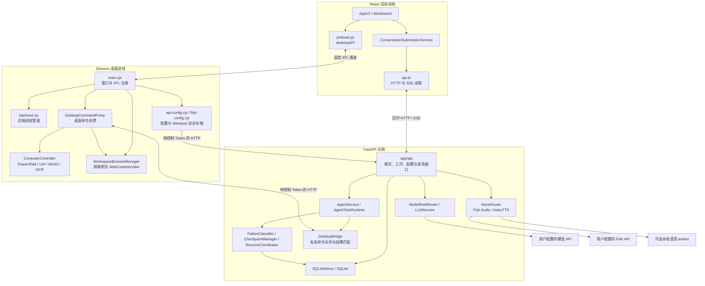

# Companion Studio 架构

本文描述当前源码中的组件和边界，供维护、排障及扩展使用。它不是功能路线图；未配置模型、语音服务或编码工具时，相应能力不会自动启用。

## 1. 进程与数据流

- **Electron 主进程**拥有窗口、系统剪贴板、文件选择对话框、凭据加解密、网页视图及 Windows 自动化 worker。
- **React 渲染进程**负责界面和请求呈现。界面通过固定 `desktopAPI` 方法访问主进程，不能直接取得 Node.js 或原始 `ipcRenderer`。
- **FastAPI**负责角色上下文、聊天和任务逻辑、模型调用、数据库及语音生成。桌面进程启动的后端只监听 `127.0.0.1`。
- **SQLite**位于应用数据目录的 `chat.db`，由 SQLAlchemy 管理；启用 WAL 和忙等待。源码中的数据库与角色迁移在后端启动时执行。

## 2. 启动、目录与退出

`desktop/electron/paths.cjs` 计算应用 home，并创建 `UserData`、`Cache`、日志、Chromium session 和崩溃转储目录。`COMPANION_HOME` 可指定 home；否则由已打包程序的位置或开发源码位置推导。安装/开发启动入口负责选择正确的 home，核心模块不硬编码某台机器的盘符或用户名。

`backend.cjs` 从当前应用的配置读取端口，生成本次进程独有的控制 Token：

1. 已打包版本若发现端口已有健康后端，会拒绝启动，避免接管其他实例的数据或服务。
2. 已打包版本启动资源目录内的 `companion-backend.exe`；开发版本启动当前项目的 Python 虚拟环境。
3. 环境变量显式传递应用数据目录、父进程 PID、控制 Token 和可选 worker 路径。干净发行版清除继承的模型/语音密钥，再从本产品的已保存配置恢复服务。
4. 健康检查成功后加载 React 页面。发行版由 FastAPI 的 `/app/` 提供静态页面，开发模式使用 Vite。
5. 主窗口关闭后清理网页视图、项目文件观察器、媒体服务、桌面命令泵和本实例后端。

`backend/run.py` 还监视 Electron 父进程：Windows 上父进程异常消失时，后端退出。各服务只处理自己拥有的子进程；不得按通用进程名称结束另一套应用。

| 资源 | 所有者 | 释放位置 |
| --- | --- | --- |
| 本地后端子进程 | `backend.cjs` | `stopBackend()`，以及后端父进程监视 |
| 主窗口与附属窗口 | `main.cjs` | 主窗口 `closed` / 应用退出事件 |
| 网页标签与 WebContentsView | `WorkspaceBrowserManager` | 标签关闭 / `dispose()` |
| Windows 自动化 worker 与请求映射 | `ComputerController` | worker `exit` / `stop()` |
| 桌面任务观察计时器 | `ApplicationMonitor` | 任务结束 / `stop()` |
| 项目目录观察器 | `main.cjs` | 切换观察目录 / 应用退出 |
| 后端任务与语音服务 | FastAPI lifespan | lifespan 的 `finally` 清理 |
| 前端流与语音呈现 | `ConversationSubmissionService` 等 | 停止请求、切换呈现或服务清理 |

表中列出当前释放入口，不代表全部异常边界已有回归。已知 worker 故障与网页 session 监听清理问题见 [工程审计](ENGINEERING_AUDIT.md)。

## 3. IPC、HTTP 与 SSE

### IPC

`preload.cjs` 暴露窗口操作、角色管理、配置保存、文件选择、媒体控制、工作台布局等固定方法。`main.cjs` 注册对应通道，大多数通道先调用 `requireMainWindow()` 核验发送方是本应用主窗口。

主进程接收界面请求后，直接执行系统接口，或调用本地后端。控制类后端请求带 `X-Companion-Control-Token`；Token 留在主进程及后端，不能通过 preload 传给网页。

### HTTP 与事件流

`desktop/frontend/src/api.ts` 封装界面的普通 HTTP 请求及 `text/event-stream` 读取。聊天与工作任务使用 HTTP/SSE；当前架构没有用 WebSocket 替代它们。Fish 提供者内部选择的语音传输方式是另一条链路。

常见链路：

- 聊天：`/api/chat` 或流式聊天接口 → `CharacterPromptBuilder` → `ModelRoleRouter` → `LLMService` → 保存用户/助手消息。
- 工作：Agent 路由、计划与执行接口 → `AgentTaskRuntime` → 工作状态事件；`/api/work/{session_id}/events` 支持按事件序号恢复读取。
- 桌面工具：后端 `DesktopBridge.request()` 入队 → 主进程 `/api/desktop/commands` 轮询 → 操作 → `/api/desktop/result` 按命令 ID 完成等待的结果。

桌面命令队列有容量和超时；空队列的轮询最多等待一秒。主进程最多保留四个在途命令，对需要鼠标/键盘输入的操作另设串行队列。

## 4. 角色、会话和模型职责

`CharacterLoader` 从随程序提供的角色目录和用户角色目录读取配置。干净发行版提供通用助手；导入角色卡、自定义角色和个性化设置属于用户数据。

`CharacterPromptBuilder` 将角色设定、最近消息、个性化和选中的记忆组成上下文。角色提示不写死在模型提供者中。业务通过 `LLMService` 调用抽象 `LLMProvider`；当前实现为 OpenAI-compatible Provider。

`ModelRoleRouter` 定义四种职责：

| 职责 | 当前用途 |
| --- | --- |
| `character_model` | 聊天、角色化回复和任务后的对话反馈 |
| `planning_model` | 任务计划中需要模型的部分 |
| `tool_execution_model` | 选择可用工具及其参数 |
| `coding_model` | 内部编码提供者的工具调用 |

每个职责可指定预设。未独立配置时会按当前路由规则回退；需要工具时跳过明确标记不支持 Tool Calling 的模型。配置能力和实际观察到的能力分开记录，未知能力不当作已验证能力。简单、本地可确定的指令可绕过模型规划。

`api-config.cjs` 保存不含明文密钥的预设信息，用 Electron `safeStorage` 加密密钥；解密后的密钥仅通过控制接口传给后端。语音配置有独立的 `fish-config.cjs`。源码和发行包不携带用户的运行档案。

## 5. Windows 应用发现与受控操作

```mermaid
flowchart LR
  Query[应用名称或用户选择的入口] --> Resolver[RuntimeApplicationResolver]
  Resolver --> Cache[ApplicationDiscoveryService\n当前应用索引]
  Resolver --> Scan[discover-applications.ps1\n注册来源定向查询]
  Scan --> Normalize[application-record.cjs\n归一化及合并启动候选]
  Normalize --> Cache
  Cache --> Launcher[AppLauncher\n候选排序与启动]
  Launcher --> Observe[AppLaunchVerifier\n进程和窗口验证]
  Observe --> Controller[ComputerController\n授权窗口操作]
  Controller --> Worker[windows-worker.ps1\nUIA / Win32 / OCR]
  Worker --> Result[观察结果与完成证据]
  Result --> Runtime[AgentTaskRuntime / GoalVerifier]
```

发现脚本读取卸载登记、App Paths、开始菜单、桌面快捷方式、AppsFolder、注册应用/协议和当前进程等来源；定向查找按登记来源、运行进程、Start Apps 分层查询，不递归扫描整个安装盘。

`normalizeRecord()` 生成稳定应用 ID 和启动候选；合并时保留成功入口、别名和历史计数。部分扫描不能将无关缓存条目标记成已卸载。`AppLauncher` 按候选类型使用无 shell 的进程启动、Windows 快捷方式、AppsFolder 或已登记协议；启动请求被接受后仍须观察真实应用窗口，不能只凭进程创建成功宣告目标完成。

自动化 worker 接收 JSON 行请求，先匹配已授权应用的进程及窗口，再执行控件读取、OCR、搜索、点击或输入。窗口不属于目标应用、桌面锁定或输入时目标失去焦点，会拒绝操作/暂停任务。音乐适配器负责客户端搜索结果分类、匹配和播放验证；不能将打开网站、选择专辑或仅发出播放请求当作歌曲已播放。

Windows PowerShell 5 中含中文选择器的脚本必须保留 UTF-8 BOM，尤其 `windows-worker.ps1` 与 `qqmusic-automation.ps1`；JavaScript 格式化工具不应重写这些脚本。

## 6. 网页视图与权限边界

`WorkspaceBrowserManager` 创建独立 partition 的 `WebContentsView`，开启 sandbox、上下文隔离和 webSecurity，关闭 Node.js；网页不使用应用 preload。新窗口默认拒绝，导航与重定向经过 HTTPS URL 策略。下载要求用户确认，保存到应用下载目录，不自动执行。

`browser-automation.cjs` 用 CDP 读取 DOM 就绪状态、语义搜索框和结果链接。搜索返回包含查询反映、导航和结果链接等证据；验证码、登录或网络错误不会被当成完成。

URL 策略用于拒绝不允许的协议、凭据及明显本机/私有 IP 地址，**不是 DNS 解析层的完整网络隔离**。网页文本属于外部内容，读取结果不能作为权限授权依据。权限由 `trusted_actions`、任务检查点和主进程授权路径决定。

项目文件工具通过已选择工作目录和路径校验限制访问。代码草稿与写入项目分开；保存/应用由当前权限规则决定。选择附件并发送时，附件会进入当前模型请求；这与浏览器自动化或模型能力配置是不同的权限和数据路径。

## 7. 任务与 Workbench 的关系

会话、任务执行和布局是三个不同对象：

- **会话**拥有角色 ID、消息和模式。`ConversationSubmissionService` 在请求开始时固定归属；导航到其他会话不会让事件写入当前可见会话。同一会话排队，不同会话可并发。
- **工作任务**有工作 session、目标、步骤、权限等待、观察结果及完成状态。后端 `AgentTaskRuntime` 执行，`WorkState` 发布并保存工作状态；重启时恢复历史状态并标记中断任务。
- **Workbench 布局**只负责模块位置、尺寸、停靠、可见性和活动模块，不能决定任务权限或替代执行结果。

`AgentOutputRouter` 将工作 session 中的代码、Diff、终端、文件、网页、应用、媒体和系统结果映射到 `WorkspaceModuleRegistry` 的对应模块。`Workbench` 呈现这些模块及工作流/事件；未完成任务会继续显示真实状态，界面卡片本身不是成功证据。

`WorkspaceLayoutEngine`、`WorkspaceSplitLayoutEngine`、缩放及自动滚动控制器处理交互。`WorkbenchLayout` 通过 IPC 将布局保存到用户的 `workbench-layout.json`；浏览器运行时可回退到 localStorage。布局与聊天/密钥独立保存，并保留旧版布局迁移资料。

## 8. 可选语音与编码后端

语音由 `VoiceRouter` 在 Fish Audio 与本地 IndexTTS 客户端之间路由。文本与语音事件分别生成；前端 `VoicePresentationService`、`FirstSpeechGate` 和音频队列负责播放及呈现同步。切换会话会解除当前听觉呈现，消息归属仍由原请求决定。无语音配置时可正常使用文字聊天。

编码任务经 `CodingAgentService` 使用内部模型工具循环，或用户选择的 Codex CLI Provider。草稿模式使用虚拟文档/隔离目录；写入项目模式取决于明确的写入意图和权限。Codex CLI、模型额度及本地语音模型都不是安装包自带服务。

## 9. 扩展和维护入口

| 需求 | 主要入口 |
| --- | --- |
| 新模型 Provider | `backend/app/services/llm/base.py`、`service.py` |
| 新模型职责或能力规则 | `backend/app/services/llm/model_roles.py` |
| 新任务工具 | `agent_tools.py`、`desktop/runtime.py` 与权限映射 |
| 新桌面应用来源 | `application-discovery.cjs`、`automation/discover-applications.ps1` |
| 新客户端自动化策略 | 客户端适配器、`ComputerController` 和 worker 的受控操作 |
| 新工作台模块 | `WorkspaceModuleRegistry`、`AgentOutputRouter`、`Workbench` |
| IPC 增补 | 主进程 handler、preload 固定方法、`vite-env.d.ts` 和对应回归 |

工程整改需保持请求字段、事件归属、权限规则和既有交互；格式化、注释、独立故障修复分别留有验证证据。更多工具和任务细节见 [工具系统](TOOL_SYSTEM.md) 与 [Agent 运行时](AGENT_RUNTIME.md)。

审核分支的恢复层复用原任务锁、权限、执行器、Trace 和 Evaluation。运行前提交意图，异常按固定
Schema 分类，再按预算和当前证据恢复；重启不自动重放。工作流中提供续接面板，评测中新增
Recovery Core 16 项合成故障。设计和当前限制见 [检查点](CHECKPOINT_DESIGN.md) 与 [恢复安全](RECOVERY_SAFETY.md)。

## 10. MCP 与 Agent Skills 扩展（本地候选版）

`services/mcp_ext` 使用官方 SDK 连接手动授权的 stdio / Streamable HTTP Server。
外部工具经过独立命名空间、Schema 指纹、本地风险审阅和原有执行器授权，结果标记为低信任数据。
协议成功与目标验证分别记录，不将外部服务器的自报成功当成整个任务完成。

`services/skills` 解析标准 `SKILL.md`，先匹配元数据，再按需加载一份说明及显式请求的参考文件。
Skill 不授予权限，不启动 `scripts`；脚本文件仅可查看。新增 SQLite `extension_records` 表以
增量方式存储元数据，凭据由 Electron 主进程加密保管，只在当前连接内存使用。

详细边界见 [MCP 架构](MCP_ARCHITECTURE.md)、[工具生命周期](MCP_TOOL_LIFECYCLE.md)
与 [Skills 开发](SKILLS_DEVELOPMENT.md)。布局、缩放、拖拽和滚动引擎不属于此次扩展的修改范围。
