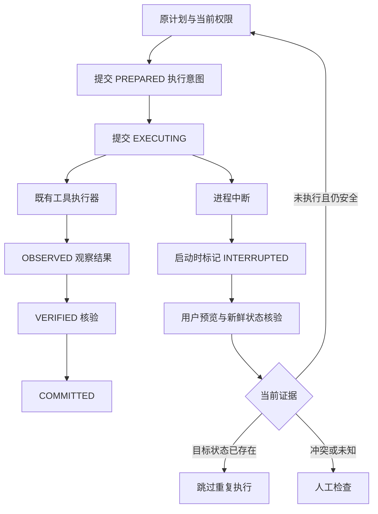

# Durable Checkpoint 设计

## 执行链路

事务不跨工具、await 或用户等待。意图提交失败时工具不能开始。观察或结果持久化失败后，
不假定工具未执行；下一次必须核验真实状态。SQLite WAL/事务保障本地已提交记录，
不承诺硬盘/文件系统灾难后恢复。

Trace 写入使用独立的短等待连接，在读取前 BEGIN IMMEDIATE 预约短写事务，避免读后升级竞争。
仅对 SQLite busy/locked 的已回滚投影事务在 2 秒预算内有限重试（最多 16 次短事务），
有限异步退避，不增加业务连接等待，也不重复工具。最终失败仍计入 dropped/incomplete；
Evaluation 缺失任何任务 Trace 时判失败，不把残存的其他片段当作完整证据。

## 表与迁移

`migrate()` 幂等新增三表和 `studio_schema_migrations` 的 `agent_recovery=1`：

|表|字段与职责|
|---|---|
|agent_recovery_tasks|逻辑任务、Conversation/WorkSession/Renderer 归属、原 Trace、最新执行 UUID、计划/工作区哈希、状态、revision、租约、请求 UUID、预算、计数与固定错误|
|agent_checkpoints|schema_version、唯一 task/step_index、确定性 step UUID、唯一 operation UUID、工具调用编号、幂等键、副作用类别、意图/结果摘要、权限状态、UTC|
|agent_recovery_attempts|策略、错误码、起止状态、实际恢复耗时、布尔证据|

不重建 messages / conversations / work_sessions / trace / evaluation，不回填旧任务。
未来版本号会显式拒绝读取；损坏的 JSON、计划或字段不默认为成功。迁移不删除用户数据。

## 身份、幂等与并发

- step UUID = UUID5(逻辑 task UUID, tool_call_id)；幂等键摘要包含任务和完整原调用。
- 新操作意图拥有 operation UUID。重试复用同一个逻辑操作，防止被当作新授权。
- 状态更新使用 state + revision 的数据库 CAS，防止取消后迟到回调覆盖终态。
- Resume 领取持久租约，绑定 request UUID / 新执行 UUID；重复相同请求返回 duplicate。
- RuntimeRegistry 的原会话锁和全局门仍生效；预览也受原注册器约束。
- finally 释放本次租约、协程和映射；启动时回收已中断实例的租约，不重启旧协程。
- 执行中的只读检查点只有在新续接租约、当前核验和授权下可再次读取；相同状态的副作用工具仍被拒绝。
- 复核、领取租约和工具本身不在同一外部事务中。文件在复核与准备/复用之间改变时再次拒绝。

## 保存和核验什么

文件意图只记录相对路径、写前哈希、预期哈希和物理/草稿类别，不复制文件正文。
读取上限 1 MB；较大或非普通文件标为不可核验。写入内容沿用工具的 100 KB 限制。
Windows 实际写入的换行字节参与哈希；虚拟草稿使用草稿内容哈希。
路径仍经过原执行器的目录边界、私密文件和符号链接检查。

恢复不信任历史 `success=true`：文件比对当前哈希；支持的桌面只读状态通过现有桥重新读取；
窗口/网页/未知脚本效果证据不足时转 REVIEW。当前普通列表/搜索结果的已提交检查点保守转 REVIEW。
工具 app/browser/media/music 的副作用需要显式 verified=true，单纯请求已排队不能提交成功检查点。

## 状态与保留

任务包括 INTERRUPTED、RECOVERY_AVAILABLE、REVALIDATING、WAITING_USER、RESUMING、
RECOVERING、COMPLETED、FAILED、CANCELLED、UNRECOVERABLE、NEEDS_REVIEW。
允许转换在 `recovery/types.py` 集中定义；完成发生在 GoalVerifier 通过且 assistant 消息保存后。

启动清理只处理本档案。`prune()` 每次最多删除 100 个超过 30 天、无租约的终态恢复记录及其子表，
不删除聊天、工作会话、Trace、项目或文件。中断/待检查任务没有后台自动删除任务。
历史检查点可保留，但 30 分钟执行年龄预算耗尽后不能再续接。
