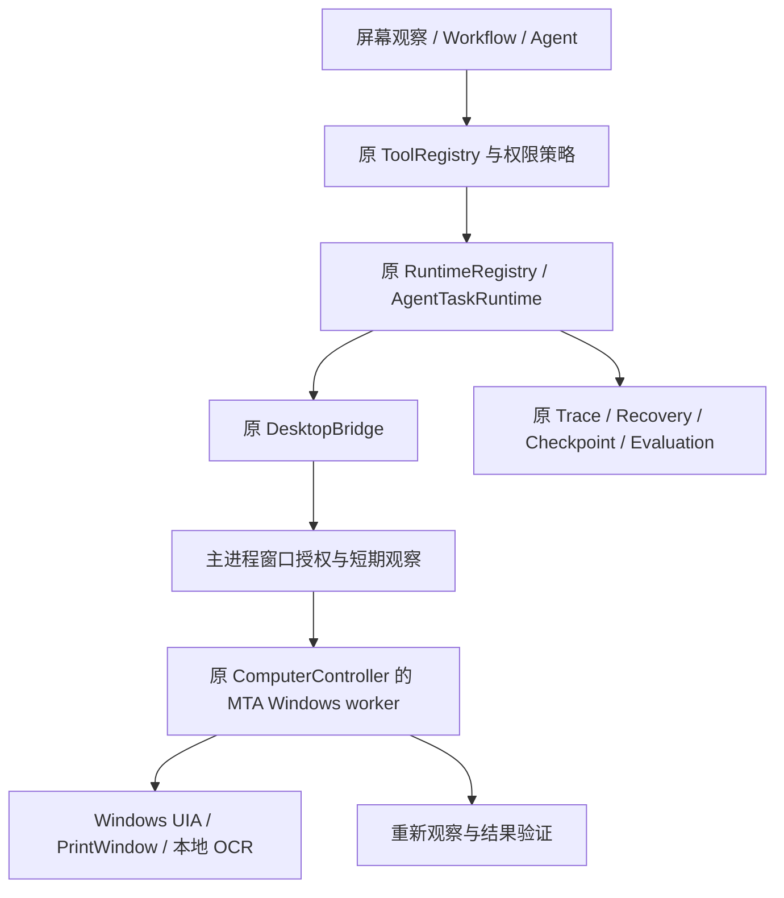

# Visual Computer Use 架构

候选 `0.2.0-visual.1`；默认关闭。不是通用无人值守桌面接管。

Backend `services/computer_use` 定义严格参数、工具、上下文和返回白名单；不接收任意 HWND、程序路径、脚本或点击坐标。七个工具：`computer.observe`、`find_element`、`click`、`type_text`、`scroll`、`focus_window`、`wait_for_state`。

主进程原应用索引列出已安装应用。用户选择真实窗口并在原生对话框确认后，创建会话/角色所属的随机授权 ID，绑定进程启动时间、PID、HWND、可执行文件和有效期。后端工具 ID 不构成授权。观察和候选约 8 秒有效，窗口授权 15 分钟失效。每会话最多一个窗口、全局最多 16 个。

UIA 优先，本地 OCR 只在允许窗口截图后使用。浏览器 DOM 继续使用原浏览器工具和授权上下文；`source=dom` 在通用 Windows 定位器明确拒绝并提示使用浏览器工具，不能借此操作外部浏览器。Vision 返回建议，不进入自动执行路径。

工作台模块按需加载，2 秒读取缓存元数据，捕获只由明确操作触发。新增模块默认关闭，保留原布局版本、坐标计算、rAF、拖动与缩放机制。

## 使用

工作模式 → 模块 → 屏幕观察。选择应用与窗口，按需勾选窗口预览/OCR，在原生确认框授权。聚焦、观察，填写目标说明和可选 AutomationId，定位唯一元素后输入或提供验证条件再点击。可随时暂停、停止或接管。窗口重建、重启或授权失效后重新观察。

原 Workflow Schema 1 增加 `computer_use` 节点，配置 `{action, arguments}`；执行仍走原工具桥与人工权限节点。MIT 示例 `visual-desktop-automation` 不包含窗口授权；运行前填写本会话授权 ID。JSON 参数引用遵循原工作流变量规则。

## 代码索引

- `backend/app/services/computer_use/`：契约、Runtime、Vision 生命周期、原生评测。
- `desktop/electron/computer-use*.cjs`：会话窗口能力和固定 IPC。
- `desktop/electron/automation/visual-*`：原 worker 的观察、定位和执行。
- `desktop/frontend/src/computer/`：本地 Visual Observer。
- `tests/ui/computer-use-e2e.cjs`：真实原创 Windows Fixture 的完整闭环。

详见[动作安全](COMPUTER_ACTION_SAFETY.md)、[截图隐私](SCREEN_CAPTURE_PRIVACY.md)、[QA](AUTOMATED_QUALITY_GATES.md)。
