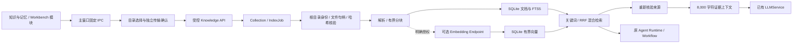

# 本地知识架构

候选版本：`0.2.0-knowledge.1`。此功能在本地审核分支，未改变已发布版本。

模块位于 `backend/app/services/knowledge/`。数据继续存放当前独立档案的 `chat.db`，
不读取其他版本档案，不建立云索引或独立 Agent 执行器。原工具权限、会话所有权、
RuntimeRegistry、Trace、Checkpoint、Recovery 和 Evaluation 继续生效。

新增表：`knowledge_collections`、`knowledge_documents`、`knowledge_chunks`、
`knowledge_index_jobs`、`knowledge_grants`、`knowledge_preferences`、
`knowledge_evidence`、`knowledge_vectors`；FTS5 虚表为 `knowledge_fts`。
长期记忆增量扩展原有 `manual_memories`，不另建竞争记忆表。

主要 API 均以 `/api/knowledge` 开头，要求主进程私有控制 Token。
客户端不能从 preload 获得这个 Token、API 密钥或任意 URL 请求能力。

本次没有新 Python / npm 依赖。PDF 使用已锁定的 pypdf，DOCX 使用标准库。
Embedding 默认禁用；用户自行准备的本地 API 或明确授权的 HTTPS API 是可选增强。

参阅：[目录授权](KNOWLEDGE_COLLECTIONS.md)、[索引](KNOWLEDGE_INDEXING.md)、
[检索](RAG_RETRIEVAL.md)、[引用](RAG_CITATIONS.md)、[记忆](LONG_TERM_MEMORY.md)、
[安全](KNOWLEDGE_SECURITY.md)、[评测](KNOWLEDGE_EVALUATION.md)。
