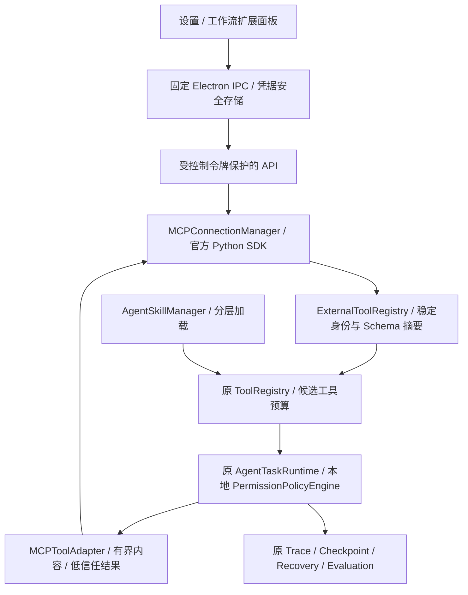

# MCP 与 Agent Skills 架构（本地开发）

本阶段基于已验收的 Recovery 分支 `844c48a`，在独立
`feature/mcp-skills-extension` 分支实现；不覆盖正式安装、用户档案或个人版。

## 协议与依赖

实际核对的官方稳定 SDK 为 Python `mcp==2.3.0`；新协议
`2026-07-28` 不使用旧式初始化会话。使用 SDK 的 auto 探测和旧式回退，
不手写另一套版本协商。SDK 依赖的 httpx2 与既有 httpx 分开，既有依赖版本保留。
参考：[协议版本](https://modelcontextprotocol.io/specification/2026-07-28/basic/versioning)、
[Python SDK](https://py.sdk.modelcontextprotocol.io/client/)、
[Agent Skills](https://agentskills.io/specification)。实现与测试结果以最终报告为准。

后端持有 MCP Host、注册表和 Skill 内容；React 不启动程序，不拿控制令牌或已保存密钥。
Electron 安全存储只交付指定 Server 的凭据给本实例后端内存，不写入 SQLite、日志或导出。
本地程序经用户审批启动，使用无 shell 的独立子进程、收缩环境、有界管道和自有进程 Job。
这是生命周期约束，不是 OS 权限沙箱；外部程序仍具有当前 Windows 用户权限。

连接手动建立，启动不自动运行 Server。所有外部工具默认禁用且为高风险，Server 注解不能
降低风险。用户审阅并启用工具之后，模型仍只能提出参数；本地 Schema、摘要、当前启用状态、
原权限策略和执行前审批共同决定是否执行。重连不重放调用，未知副作用进入人工核验。
Skill 内容和 MCP 结果均为低信任数据，不能修改系统提示、添加可信 Server 或授予权限。
