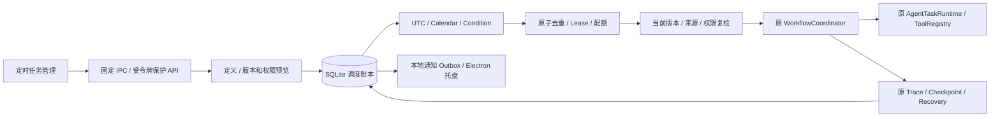

# Scheduled Agent 架构

此功能属于 `0.2.0-scheduler.1` 本地候选，公开下载仍以 README 的 Release 链接为准。

`backend/app/services/scheduling` 只安排执行机会：

- `definitions`：创建、预览、CAS 编辑、手动触发、本次同意和逐节点验证。
- `time_rules`：可测试时钟、UTC 与本地日历。
- `conditions` / `directory_pin`：授权来源及有界元数据监控。
- `store` / `occurrences`：短事务、唯一键、领取、容量和结算。
- `coordinator`：每秒唤醒、合并错过触发、交给原工作流。
- `monitor` / `recovery`：观察原运行及显式续接，绝不另建执行器。
- `notifications`：持久投递意图；主进程调用 Windows 原生通知。

API 位于 `/api/scheduler`，继承原主进程控制令牌。渲染器没有任意 URL、命令、
模型密钥或永久权限接口。后台启动前先持有档案 OS 文件锁，避免第二个后端在恢复阶段
修改第一个后端的账本。数据库 Lease 再保护调度主实例；不是分布式 Exactly Once。

工作流只能绑定不可变的已发布版本。原执行器继续负责工具、模型预算、权限、取消、
检查点、来源授权和桌面安全；MCP、Skills、RAG、Computer Use 的原约束继续生效。
版本依赖改变时暂停审核。新增计划不会自动连接 MCP、安装服务、下载模型或创建默认任务。

完整退出停止调度、关闭自己的运行和进程。存储故障时保留错误并用内存中的精确归属
清理自己的协程；下次启动仍保守检查持久账本。各服务独立清理，单个异常不跳过其余资源。
