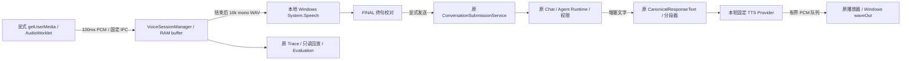

# 实时语音会话

这是 `0.2.0-voice.1` 本地审核候选的源码能力，未表示已公开发布。
它在原有 Chat / Work 中增加持续存在的语音会话，每句话由用户开始、结束、校对和发送。
默认不开麦、不下载模型；当前没有自动免提或原生增量转写。

## 使用

1. 先在设置中配置自己的文字模型，选择聊天或工作会话及角色。
2. 点击输入框旁的麦克风按钮，选择输入、输出、中文或 English。
3. 选择「系统语音」或已经配置好的语音引擎。云端朗读另需允许发送回复文字。
4. 「开启语音会话」会出现原生确认框，但此时仍未采集。
5. 点击「开始录音」或选择按住说话，结束后等待本地终句转写。
6. 校对「识别终句」后点击发送。只有这一步会调用现有模型和 Agent。
7. 「打断回复」停止本轮输入、生成及播放；可继续下一句。「停止」释放会话。

例如中文问候经本地转写为「你好今天过得怎么样」，校对发送后原聊天保存一条用户消息、
一条模型回复。回复文本按语义分段进入 TTS，首段可在后续模型文字生成时播放。
模型和语音服务未配置时不会产生示例回复。系统音色不等于导入角色的克隆音色。

## 数据流

后端 `services/realtime_voice` 拥有生命周期、严格协议、ASR/TTS Router、临时目录及缓存边界。
ASRProvider 协议目前只提供真实 Batch 接口；没有伪造返回 Partial。
WindowsSpeech 的每个请求启动独立、可取消的本地 helper，不长期占用麦克风。
前端 `realtimeVoice` 拥有设备和录音轨道；主进程固定 IPC 绑定自己的 renderer UUID。
不引入第二套对话、工具执行器、工作流引擎或权限数据库。

## 状态与取消

Session：IDLE、INITIALIZING、LISTENING、SPEECH_DETECTED、TRANSCRIBING、PROCESSING、
SPEAKING、INTERRUPTING、PAUSED、STOPPED、ERROR。SPEAKING 依据播放器开始观察，非模型成功措辞。
Turn：CREATED → CAPTURING → FINAL_TRANSCRIPT → GENERATING → SYNTHESIZING → PLAYING → COMPLETED。
错误及取消可以进入 FAILED / CANCELLED；Partial 状态保留给将来真正提供该能力的引擎。

所有异步入口绑定会话、Turn、generation、conversation、character。取消先同步失效，
再停止自己的轨道、ASR helper、LLM/TTS workers 和播放器；旧结果不可写回新轮次。
原生 Index worker 必须确认取消后才释放原语音信号量，避免晚返回污染下次请求。
隐藏窗口、切换会话/角色、离开界面、设备断连及应用退出会停止输入。
定时任务和托盘不能授予麦克风权限或自动开始录音。

VAD 是能量检测，200ms 声音活动及 1400ms 静音只形成候选，不触发工具。
每句 30 秒上限；前端 29 秒停止，后端 31 秒 watchdog 兜底。长停顿不代表批准或执行。
存在回声/AEC 未验收风险，所以免提及语音 barge-in 暂不开放；播放中可手动打断再录。

## 原 Agent 集成

语音发送复用角色、记忆、知识库、已授权 MCP/Skills、Computer Use 和原工具权限。
聊天会话不会因语音识别而悄悄改成工作会话；执行任务前先切换工作模式。
权限批准和应用候选选择保留原语音快照，不采用之后改变的全局云端语音设置。
说「确认」不能代替原生权限确认框；终句也不能批准之前的高风险计划。

新增 `workflow.list/run`、`scheduler.list/status/pause` 是原工具注册表的窄适配器。
run 指定已发布的固定版本，返回 queued 和原 run_id，不提前声称完成，也不持有 Agent 锁等待子工作流。
run / pause 始终高风险，参数摘要参与授权，未知副作用不自动重试。
Scheduler 查询只返回当前会话的元数据；pause 有 revision 检查，不取消已经运行的 occurrence。
工作流节点拒绝再调用这些编排工具，避免递归及绕过预算。

相关：[Provider 能力](VOICE_PROVIDERS.md) · [隐私](VOICE_PRIVACY.md) · [评测](VOICE_EVALUATION.md)。
