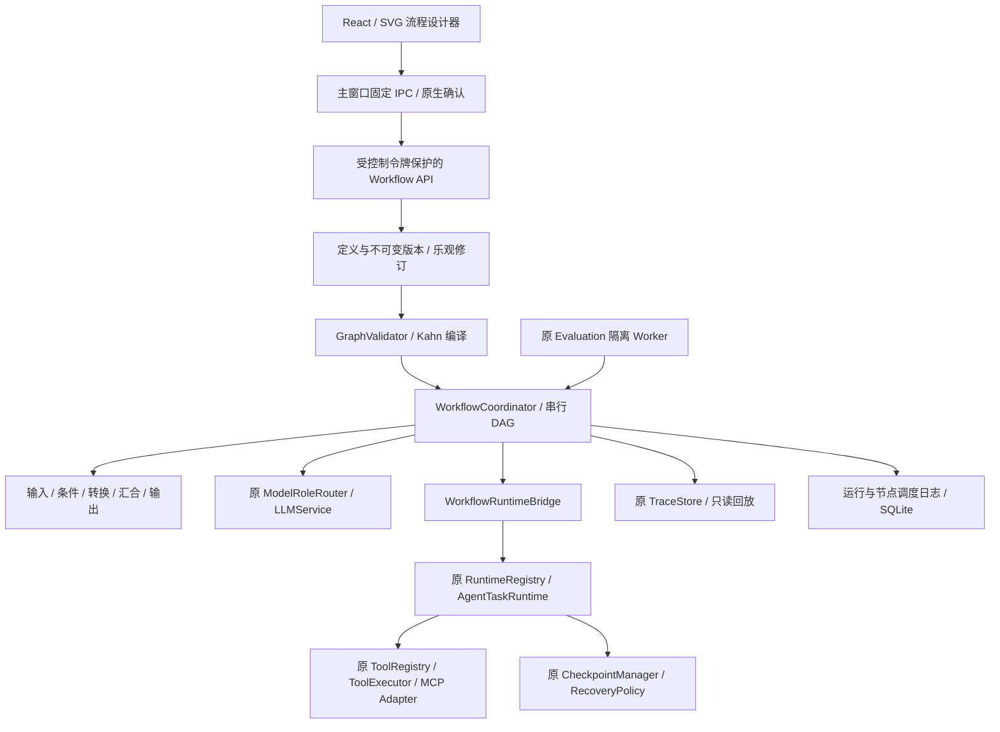

# Visual Workflow Builder 架构

本地审核候选为 **0.2.0-workflow.1**，基于已验收的 MCP & Skills 分支。公开的 v0.1.2 不包含
此功能；这次不移动 main、不打 Tag、不自动发布 Release。原工作台中的「工作流」继续显示
Agent 步骤与恢复；新增入口为「工作模式 → 模块 → Visual Workflow · 流程设计」。

## 模块职责

| 模块 | 实际职责 |
| --- | --- |
| `contracts.py` | 严格、版本化的用户协议和大小/深度限制，不依赖 SVG 坐标库。 |
| `compiler.py` / `config_validation.py` | 重复 ID、端口、循环、可达性、变量作用域、配置、Schema、能力、工具依赖检查；生成稳定拓扑次序。 |
| `repository.py` | 草稿 CAS、不可变发布版本、独立 Run / NodeRun、增量事件游标；短事务。 |
| `coordinator.py` / `scheduler.py` | 外层工作流配额、就绪判断、未激活分支传播、运行结果与生命周期。 |
| `node_runner.py` / `node_executor.py` | 节点超时、输入/输出类型、预算、受限纯节点与现有模型服务。 |
| `runtime_bridge.py` / `catalog.py` | 当前工具定义复核、已解析参数、原权限与 Agent Runtime；不复制工具实现。 |
| `controls.py` / `checkpoint_adapter.py` | 审批 Future、取消、暂停、原检查点复核与显式续接。 |
| `trace_adapter.py` | 仅固定事件、UUID、状态/计数进入原追踪系统，不保存正文。 |
| `output.py` / `port_types.py` | 有界输出、所选项目文件引用、原 Trace/Evaluation 引用与实际类型检查。 |
| `evaluation/workflow_cases.py` | 原评测 Worker 内的 20 项受控编排回归，原 Grader / Metrics / Report 评分。 |

前端分为协议、纯图操作、Canvas、节点视图、属性编辑、输入表单、运行面板、事件订阅。
首次打开流程模块才加载其代码和样式。拖动只更新选中节点的单帧预览，松手才写编辑历史；
原 Workbench 布局版本、几何阈值、共享 Resize 与自动滚动引擎不重写。

## 调度与归属

采用串行 DAG，不实现循环、定时器、云端分布式执行或后台自动恢复。最多 8 个活动/排队流程、
共享 2 个 workflow 配额；实际工具仍取得原 agent 配额和对应会话锁。锁的种类不同，避免外层
先拿 agent 锁、内层再等待自身造成死锁。同会话流程串行，其他会话可在配额内推进。

Workflow ID、Version ID、Run ID、Task ID、Trace ID、Work Session ID 和 Node Execution ID
分别生成。Run 固定版本和开始时的项目目录；切换会话不会转移审批、输出或取消其他会话的任务。
模型职责使用现有 API 配置，密钥不进入画布、版本或导出文件。

相关说明：[协议](WORKFLOW_SCHEMA.md)、[执行](WORKFLOW_EXECUTION.md)、
[变量](WORKFLOW_VARIABLES.md)、[安全](WORKFLOW_SECURITY.md)、
[模板](WORKFLOW_TEMPLATES.md)、[评测](WORKFLOW_EVALUATION.md)。
